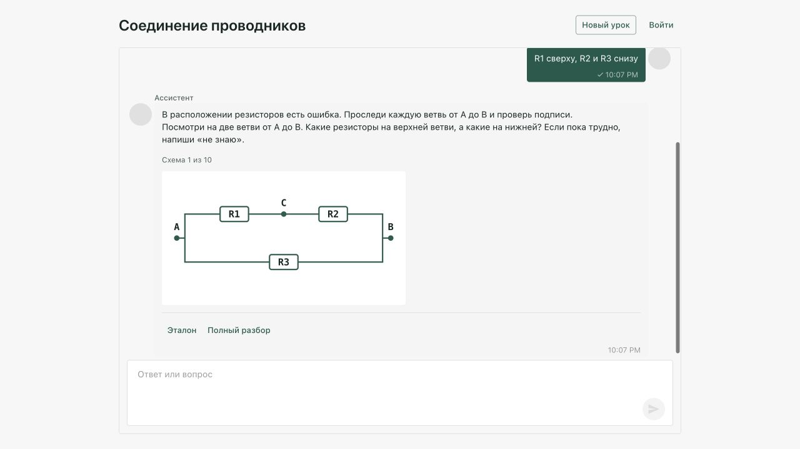
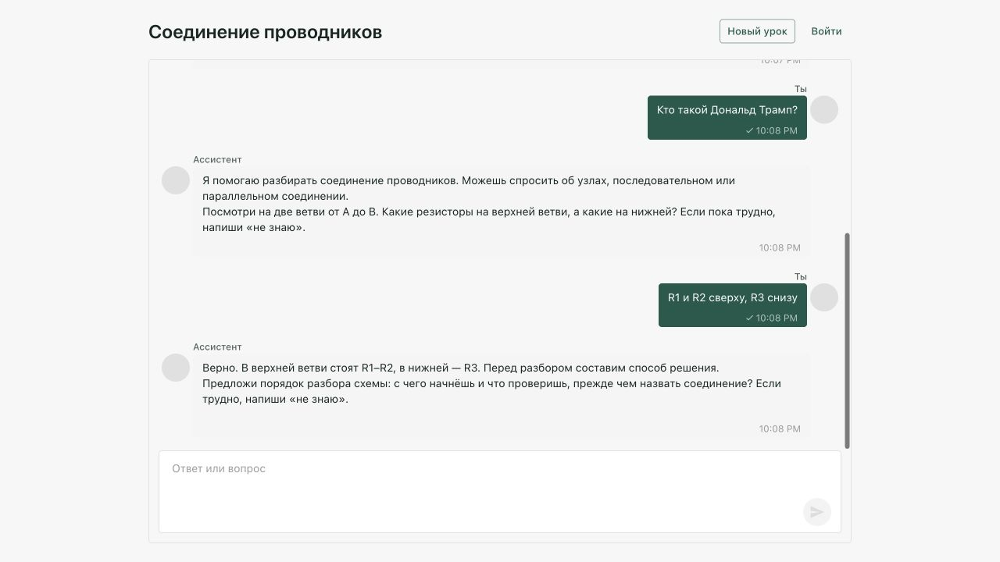
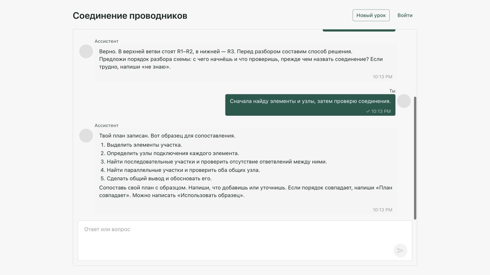
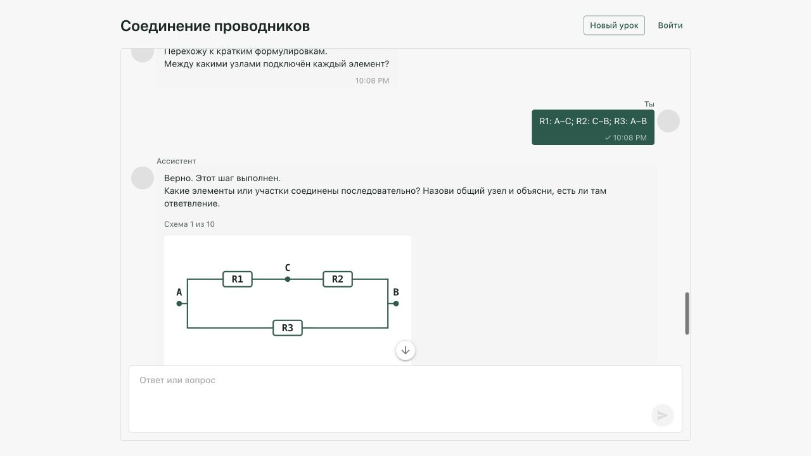
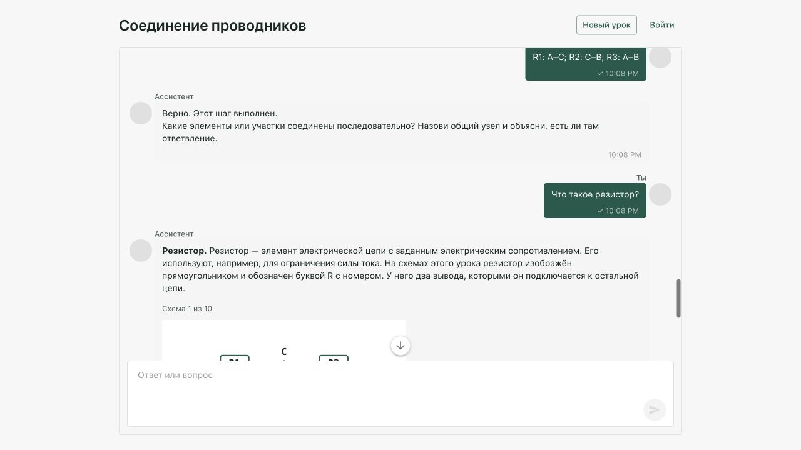
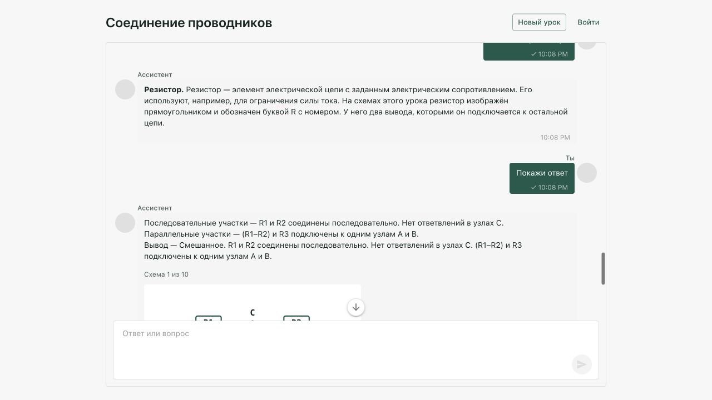
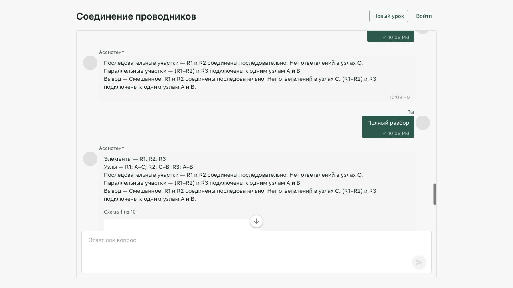
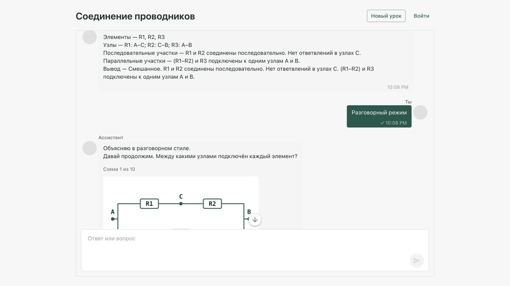
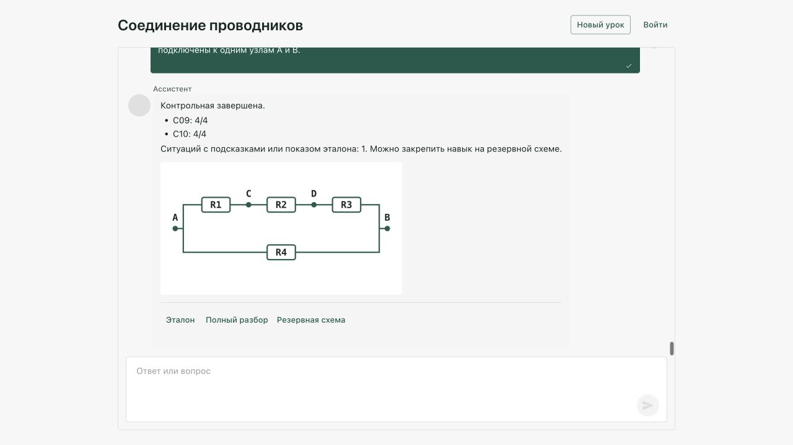

# Протокол проверки учебного ассистента

Последняя проверка: 24 ноября 2026 года. FastAPI и SQLite проверяются во временных БД; живые модельные сценарии используют GigaChat-3-Pro. Данные учеников и аккаунты пользователей в эти наборы не входят.

## Гипотезы и изменения

| Гипотеза | Проверка | Результат и изменение |
| --- | --- | --- |
| Модель путает вопрос ученика с решением задания | Смешанные реплики: правильные пары и вопрос о резисторе; вопрос после принятого ответа | Решение и вопрос обрабатываются отдельно. Извлечение не получает эталон и связи схемы; в запросе последней стоит реплика ученика. |
| Второе мнение модели не является достаточной проверкой | Неполная серия, противоречащие пары, ложное утверждение обо всех элементах | Истинность и полнота проверяются кодом по топологии. Semantic verifier диагностический и не выставляет баллы. |
| Правильная цитата не доказывает всю соседнюю прозу | Ложное основание внутри evidence, отзыв перед новым ложным утверждением | Покрытие учитывает представленные утверждения и область отзыва. Проверенные контрпримеры не получают зачёт. Гарантии понимания любой прозы нет. |
| Пустой список найденных отношений может означать неизвестность | C06/C08, скрытый контакт, отрицание существования параллели | Неизвестность отделена от доказанного отсутствия. Корректное описание скрытого контакта имеет успешный путь. |
| Текст из верного источника может не отвечать на вопрос | Вопросы о геометрии, целых ветвях, обоих концах элемента, смене схемы | Выделены план и тема помощи, фильтр источников и одна попытка пересмотра. BM25 исключает служебные слова. Физический текст выдаётся из коротких проверяемых источников. Качество релевантности оценивается отдельно. |
| Уточняющий вопрос теряет решение на подтверждении | Полный pending, вопрос, тайм-аут, отзыв, повторное подтверждение | Вопрос и ошибка провайдера сохраняют полный кандидат. Отзыв отменяет его. Без кандидата подтверждение не даёт балл. |
| При конкурирующих запросах может сохраниться неверный переход | Задержанный правильный ответ проигрывает запросу с новой версией | API возвращает 409 и откатывает проигравший ход вместе с баллом и историей. |
| Модель может пропустить буквальные данные | D01: корректные evidence с пустыми nodes | Строгая запись вида R1: C–A восстанавливается из самой цитаты; конфликтующие записи сохраняются. Условия и дополнительная проза остаются предметом общей проверки. |

## Автоматические проверки

Из каталога agent:

```sh
.venv/bin/python -m unittest discover -s tests -v
```

Проверены 69 тестов, включая аккаунты. Внутри regression-теста дополнительно выполняются 16 независимых audit fixtures. Это конечный набор, а не оценка вероятности ошибки на произвольной речи.

Набор охватывает физические эталоны 12 схем, порядок этапов и контрольную, отсутствие преждевременной подсказки, вход и права на историю, полный pending, идемпотентность, версии запросов, provenance и отрицания. API и unit используют заглушки модели; их успех не означает проверку реального понимания GigaChat.

Независимые заключения находятся в audit-dialogue-round1.md … audit-dialogue-round4.md. Прежние замечания сохраняются как история гипотез, а актуальный вердикт привязан к хешам в заключительном повторе. Результаты разных слоёв частично повторяют одни случаи, их нельзя складывать в число независимых гарантий.

## Реальная модель

Сценарии: agent/tests/followup_cases.json — исходные 10 реплик и 21 формулировка аудитора, всего 31 сценарий и 34 хода. Запуск из agent:

```sh
.venv/bin/python tests/evaluate_followups.py --pause 4 --output tests/followup_results.json
```

Запуск расходует токены. Один процесс защищён блокировкой. Ошибка провайдера останавливает прогон и не считается успешной модельной проверкой. Сохраняются исходные ответы модели, evidence, до/после, полный pending, POST→GET и хеши app и KB. Автоматический state_check проверяет переходы, но не прямоту и полезность пояснения. Содержательный разбор выполняется отдельно.

Первый прогон 23 ноября сохранён в followup_results_release_2026-11-23.json: 31 сценарий, 34 хода, 33 успешные проверки состояния. D01 не принят из-за пустых slots nodes при буквальных правильных парах. Этот неуспех сохранён и послужил основанием общего исправления разбора цитаты.

Повторный полный прогон followup_results_release_final_2026-11-23.json: 31 сценарий, 34/34 проверки состояния, 31/31 успешное обращение к провайдеру, POST→GET согласованы. После него изменены только общие пояснения KB и нейтральный текст уточнения; хеши этой промежуточной версии содержит followup_results_help_refinement_2026-11-23.json — 6 сценариев, 7/7 проверок состояния. Для версии 23 ноября также повторены 65 unit и 12 portable API-проверок: pass.

Содержательное одобрение всем репликам не присваивается. В original-7 объяснён общий признак без применения к конкретным A/B; D17 нестабильно отвечает на вопрос о смене схемы; D09 в том историческом прогоне требовал обозначений вместо номеров словами; расширение и повторная проверка описаны ниже. D02/D04 стали содержательнее после развития общих карточек. Разбор автора находится в release_review_2026-11-23.json, независимый — в audit-dialogue-round4.md. Исторические dialogue_live_results_final.json и followup_results_verified_candidate.json относятся к предыдущим версиям; их метрики нельзя приписывать текущему коду.

## Граница проверки

Сервер гарантирует сверку представленных поддержанных фактов со схемой. JSON Schema ограничивает форму извлечения; модель всё ещё может неверно понять или пропустить смысл. Coverage ограничен поддержанными конструкциями. Сложные условия о скрытом выводе и неоднозначные ссылки требуют уточнения или подготовленного варианта. Релевантность коротких пояснений может быть частичной даже при правильном физическом тексте. Ошибка провайдера сохраняет прогресс и не оценивается как ошибка ученика.

## Исторические снимки интерфейса

Снимки tests/evidence/ сделаны 20 ноября на разных промежуточных версиях. Они показывают историю проверки, а не подтверждают внешний вид и текст нового выпуска. Текущая схема, варианты и действия находятся в чате; помощь запрашивается сообщением.

1. 01-podskazka.jpg — подсказка при ошибке.
2. 02-razbor.jpg — полный разбор C01.
3. 03-kontrol.jpg — историческая отправка последнего ответа в состоянии Sending; итоговых баллов на этом снимке нет.
4. 04-forma-otveta.jpg — форма из прежней версии с вводным вопросом.
5. 05-sravnenie.jpg — прежний шаг сравнения с ответом учителя.
6. 06-progovarivanie.jpg — называние действия.
7. 07-skrytyy-vyvod.jpg — скрытый вывод.
8. 08-shema-v-chate.jpg — схема в чате.

## Совместимость сервера

Публичная проверка выявила Python 3.10.12 на сервере: asyncio.timeout отсутствует, обработка прерывалась до вызова модели. Исправлено через asyncio.wait_for с общим бюджетом очереди и запроса; asyncio.TimeoutError учитывается отдельно. Старые тестовые контексты unittest заменены на ExitStack. Исправленный архив проверен в отдельной временной папке сервера без ключа и рабочей БД: 65/65 unit и 12/12 API. Локальная проверка выполнена на Python 3.12.14.

После исправления выполнена проверка https://fizika.storozhq.ru/ с реальным GigaChat: верное расположение принято с «Верно», определение резистора сохраняет достигнутый шаг, правильные пары с отдельным вопросом принимаются. Проверены повтор message_id и конфликт версии 409. Результаты — production_smoke_results_2026-11-23.json. Скрипт smoke_live_service.py создаёт тестовый гостевой урок на опубликованном сервисе и расходует токены; не входит в автоматический unit-запуск.

После живого прогона отдельно исправлен только совместимый тайм-аут; промпты, KB и правила оценки сохранены. Хеши версии 23 ноября app/KB находятся в release_review_2026-11-23.json и независимом audit_evidence/manifest.json.


## Проверка замечаний перед сдачей 24 ноября

Восстановлены достижимые этапы trial → method → method_compare → guided. После первой попытки ученик сам предлагает способ, получает образец из пяти операций и записывает уточнение или явно принимает образец. Только затем открывается C01 с первой операции «Элементы». Предложение и сопоставление сохраняются в SQLite; вопрос и перезагрузка их не сбрасывают. Входной вопрос о цели урока не возвращён.

Синтетическая ошибка извлечения overall=mixed при буквальном «Параллельное» теперь не получает зачёт. Тип берётся из явной исходной формулировки и сверяется с топологией; отрицания, условия и альтернативы требуют уточнения. Это тест защиты от ошибочного извлечения, а не заявление о реальном ответе GigaChat. Новые регрессии находятся в test_submission_fixes.py.

Номера словами сопоставляются существующим обозначениям текущего рисунка, без создания отсутствующих элементов. Для помощи уточнено различие общего определения и применения признака к целым ветвям рисунка. Данные текущего рисунка явно отделены от прежних заданий. После неудачной проверки релевантности единственный проверенный факт рисунка не заменяется произвольной наводкой.

### Актуальные сценарии интерфейса

Новые снимки 09–18 сделаны 24 ноября в обычном браузере на локальной копии приложения, GigaChat отключён. Это проверка интерфейса, подготовленной логики и сохранения состояния. Учебные ответы для полного пути взяты из базы; этот прогон не измеряет понимание свободной речи. Живые модельные испытания вынесены отдельно.

| Сценарий | Ввод и ожидаемый результат | Наблюдение и доказательство |
| --- | --- | --- |
| Ошибка | «R1 сверху, R2 и R3 снизу»; остаться на первой попытке | Ошибка расположения, просьба проследить ветви; 09-wrong-answer.png |
| Посторонняя тема | «Кто такой Дональд Трамп?»; сохранить шаг и вернуть к теме | Границы предмета, тот же вопрос; 10-off-topic.png |
| Верный ответ | «R1 и R2 сверху, R3 снизу» | Явное «Верно», переход к предложению способа; 11-correct-method.png |
| Предложение способа | «Сначала найду элементы и узлы, затем проверю соединения» | Образец из пяти действий, запрос сопоставления; 12-method-comparison.png |
| Проверка операции | «R1: A–C; R2: C–B; R3: A–B» | Явное «Верно», вопрос о последовательном участке; 13-correct-next-step.png |
| Вопрос по теме | «Что такое резистор?» после принятого решения | Определение, та же схема, достигнутый шаг сохраняется; 14-term-question.png |
| Эталонный ответ — отдельный запуск | Кнопка «Эталон» в C01 | Последовательные, параллельные участки и общий вывод; шаг не меняется; 15-reference.png |
| Полный разбор — отдельный запуск | Кнопка «Полный разбор» в C01 | Все пять операций, включая элементы и пары узлов; шаг не меняется; 16-walkthrough.png |
| Виртуальный учитель — отдельный запуск | «Разговорный режим», затем «Краткий режим» | teacher=true, разговорное продолжение; обратная команда возвращает teacher=false, шаг сохранён; 17-teacher-mode.png |
| Контрольная | Полный путь через 2 guided, 4 spoken, 2 solo и 2 test | После двух контрольных схем показаны C09=4/4, C10=4/4; 18-control-scores.png |

Сессия сначала пройдена в интерфейсе до C01/series, затем продолжена через локальный HTTP API ещё 58 ходами. Все POST→GET согласованы; оценки получены самим приложением, без записи итогового состояния в БД. Машинный журнал — submission_ui_completion_2026-11-24.json. В отдельных 69 unit дополнительно проверен отрицательный путь контрольной с результатами 3/4 и 4/4. Заглушки и подготовленные ответы отделены от живых проверок модели.

Снимки показывают следующие действия: 09 — обратную связь об ошибке и ту же схему; 10 — возврат в предметную область; 11 — успешный ответ и приглашение предложить план; 12 — образец для сопоставления; 13 — принятые пары узлов; 14 — определение резистора; 15 — краткий эталон; 16 — полный разбор; 17 — включение разговорного тона; 18 — завершённую контрольную с баллами, а не промежуточную отправку.

### Живая проверка исправлений

submission_followups_2026-11-24.json сохраняет первый прогон, включая принятие D09 при прежнем expect=stay и два слабых пояснения. После этого ожидание D09 усилено до progress, общие правила помощи исправлены. submission_followups_final_2026-11-24.json: все три сценария обратились к реальному GigaChat-3-Pro; 3/3 перехода и сохранения состояния соответствуют ожиданию. original-7 называет целые ветви L1–L2/L3–L4 и их узлы A/B; D17 объясняет отдельный рисунок C03 с L1/L2; D09 принимает номера словами. Это три наблюдения, а не гарантия понимания любой речи.

### Снимки актуальных сценариев





















### Полный прогон сдаваемого кода

submission_live_suite_2026-11-24.json: 31 сценарий, 34 хода; 34/34 проверок состояния и POST→GET, 31/31 успешных обращений к провайдеру. Хеши app/KB совпадают с кодом этого выпуска. D09 теперь ожидает progress: распознавание правильных номеров словами проверяется строже. Это изменение ожидания отдельно сохранено в followup_cases.json.

Содержательный разбор — submission_review_2026-11-24.json. original-7 применяет признак к L1–L2/L3–L4 и A/B, D17 различает текущий и прежний рисунок, D09 принят. В D16 повторный ответ о повороте рисунка нерелевантен: вместо определения дана наводка о промежуточном узле. D05 просит уточнить состав участков; D04 объясняет общий признак без полного применения к рисунку. Поэтому результат 34/34 относится только к переходам и сохранению состояния, а не к 34 качественным пояснениям.

Локально Python 3.12: submission_unit_2026-11-24.txt — 69/69 unit, submission_api_2026-11-24.json — 12/12 portable API. Тот же кандидат архива распакован в отдельную временную папку сервера и проверен на Python 3.10: 69/69 unit и 12/12 API. Ключ и рабочая база при этих проверках не использовались. Исторические manifest и отчёты относятся к своим версиям; актуальный набор хешей приведён в submission_review_2026-11-24.json.


### Проверка опубликованного сервиса

После обновления https://fizika.storozhq.ru/ выполнен submission_production_smoke_2026-11-24.json: HTTPS и статика доступны, GigaChat настроен и отвечает; правильная первая попытка получает «Верно», затем реально проходят предложение способа, сопоставление, элементы и узлы. Вопрос о резисторе сохраняет шаг. Проверены повтор message_id, POST→GET и отклонение устаревшей версии с 409. Скрипт — smoke_live_service.py; это отдельный живой гостевой урок, не аккаунт ученика.


### Заключение независимой перепроверки

Независимый аудитор повторил 69 unit и 12 API на текущей копии и распакованном кандидате; прошёл отдельный полный урок с перезапуском приложения между ходами; проверил синтетический ошибочный overall по всему API; сверил пять user payload по AST и все страницы обоих DOCX. Вердикт: обязательные блокеры закрыты, по проверенному комплекту работа готова к сдаче. Полный текст — submission_audit_2026-11-24.txt. Содержательные ограничения D16/D05/D04 сохранены.

Аудит относится к кандидату SHA-256 a58bd0ba2df00fb37eb4111aa12e4f9b0353465d589adf7aff5d06b0870e4903 из 91 файла. После заключения в окончательный архив добавлены только этот отчёт аудитора, журнал публичного smoke и уточнение исторических формулировок протокола. Исходники app/KB, проверенные тесты и DOCX не изменялись. Наличие отчёта аудитора не означает подтверждение закрепления варианта или неизвестных требований закрытого задания СДО.
